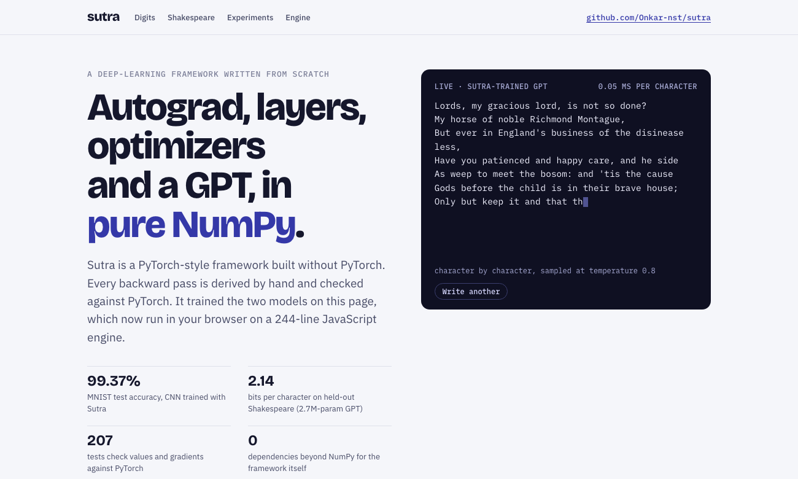
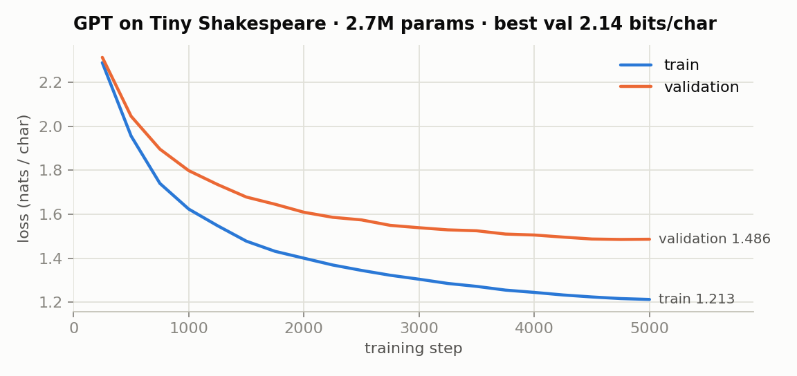
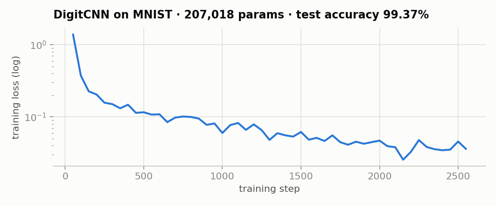
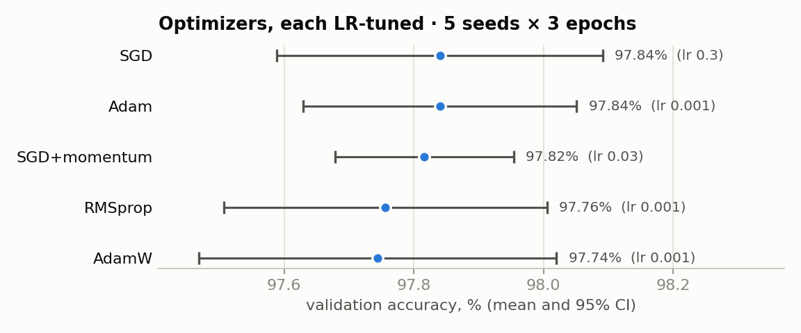
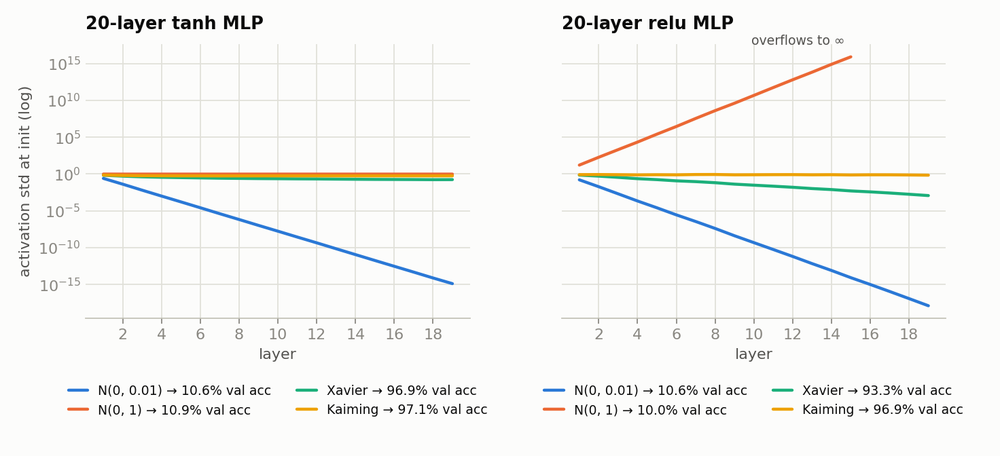
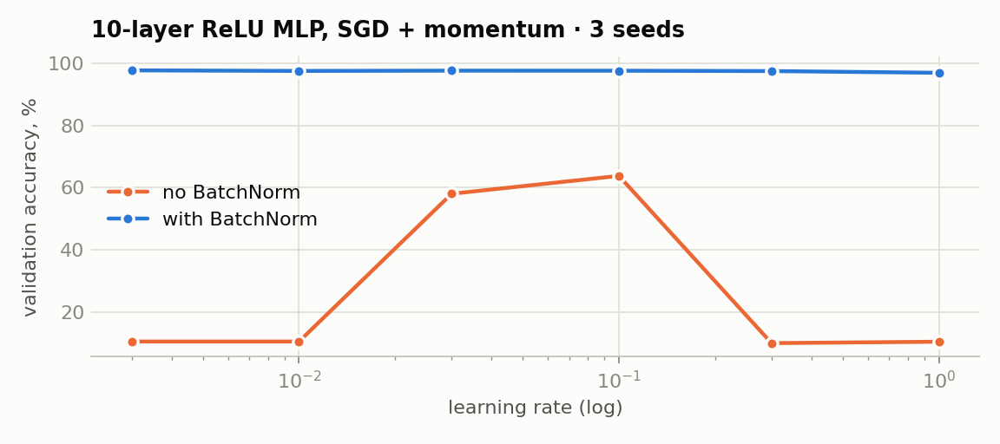
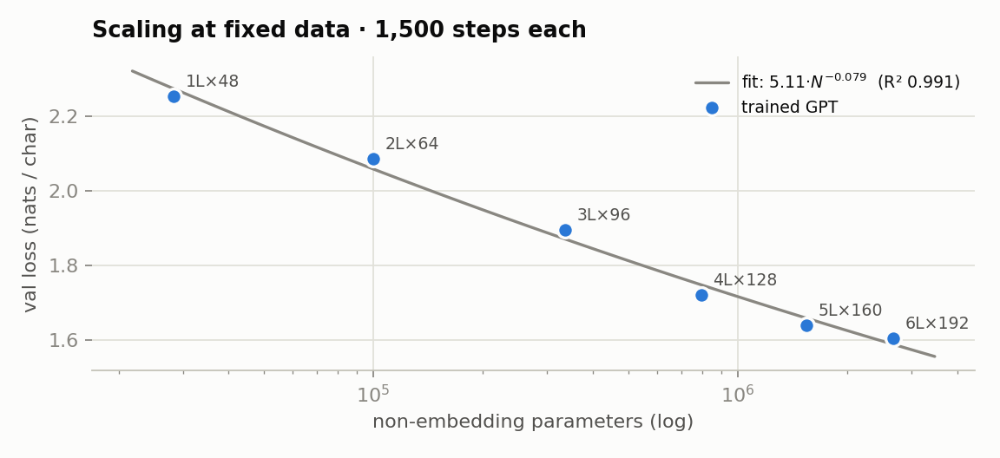
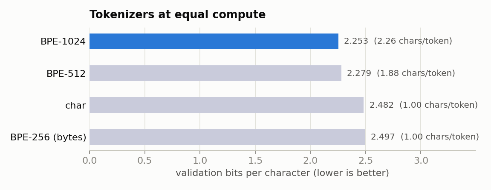

# Sutra

**A deep-learning framework written from scratch in NumPy**, with autograd, layers, optimizers, a tokenizer and int8 quantisation. It is verified op by op against PyTorch and used end to end to train a GPT and a CNN. The trained models run in the browser on a 244-line JavaScript inference engine that reproduces the Python outputs to within 6·10⁻⁶.

[](https://github.com/Onkar-nst/sutra/actions/workflows/tests.yml)



| | |
|---|---|
| **99.37%** MNIST test accuracy | CNN trained with Sutra (63 errors in 10,000) |
| **2.14 bits/char** on held-out Shakespeare | 2.7M-parameter GPT trained with Sutra on a laptop CPU |
| **207 tests** | values *and* gradients of every op, layer, optimizer and model checked against PyTorch in float64 |
| **0** dependencies | the framework needs only NumPy |
| **4× smaller** models | per-row int8 quantisation, +8·10⁻⁶ nats change in GPT loss |

---

## Why build this

Calling `loss.backward()` in PyTorch hides most of what makes deep learning work. Sutra is my attempt to own every layer of that stack. I derived each gradient by hand and wrote the kernels, the module system and the optimizers. I trained real models with them, measured what matters with controlled experiments, and shipped the result as a browser demo. Nothing is imported from an ML library. PyTorch appears only in the tests, as the reference that every result has to match.

## What's inside

| Module | What it does |
|---|---|
| [`sutra/tensor.py`](sutra/tensor.py) | `Tensor` with reverse-mode autodiff. Broadcasting-aware gradients (`unbroadcast`), non-recursive topological backward, gradient accumulation, `no_grad`, `retain_grad`, graph freeing. 40+ differentiable ops. |
| [`sutra/functional.py`](sutra/functional.py) | conv2d (im2col view + one GEMM, col2im backward), max/avg pooling, **fused attention**, LayerNorm, BatchNorm, softmax, log-softmax, cross-entropy with label smoothing and `ignore_index`, BCE, dropout, embedding. Each has a hand-derived backward. |
| [`sutra/nn.py`](sutra/nn.py) | `Module` with automatic parameter and buffer registration, state dicts, train/eval, tied weights. Linear, Conv2d, BatchNorm1d/2d, LayerNorm, Embedding, Dropout, pooling, MultiHeadAttention with KV cache. |
| [`sutra/optim.py`](sutra/optim.py) | SGD (momentum, Nesterov, dampening), Adam, AdamW, RMSprop, param groups, gradient clipping, cosine-with-warmup and step schedules. These match `torch.optim` step for step. |
| [`sutra/tokenizer.py`](sutra/tokenizer.py) | Byte-level BPE with incremental pair counting (256 merges on 1 MB in 0.4 s), plus a char tokenizer. |
| [`sutra/models/gpt.py`](sutra/models/gpt.py) | GPT-2-style decoder: pre-LN blocks, weight-tied head, GPT-2 residual init, KV-cached sampling with temperature, top-k and nucleus. |
| [`sutra/quantize.py`](sutra/quantize.py) | Symmetric per-row int8 post-training quantisation. |
| [`web/sutra.js`](web/sutra.js) | Zero-dependency JavaScript inference engine for the exported CNN and GPT. |

About 2,200 lines of framework code and 740 lines of tests.

```python
import sutra as st
from sutra import nn, optim, F

model = nn.Sequential(nn.Linear(784, 256), nn.ReLU(), nn.Linear(256, 10))
opt = optim.AdamW(model.parameters(), lr=1e-3)
for x, y in loader:
    loss = F.cross_entropy(model(x), y)
    opt.zero_grad()
    loss.backward()
    opt.step()
```

## How correctness is established

A framework that is "roughly right" trains badly without ever raising an error, so every claim here is tested:

1. **Every op against PyTorch.** [`tests/conftest.py::check`](tests/conftest.py) runs the same computation in Sutra and PyTorch on identical float64 inputs. It backpropagates the *same random upstream gradient* through both and requires the output and every input gradient to agree to 1e-7. Using a random upstream gradient tests the full vector-Jacobian product, not just the gradient of a sum. Broadcasting, batched `matmul`, advanced indexing with repeated indices, strided or padded convolutions, and causal or padded attention are all covered.
2. **Finite differences**, independent of PyTorch, for composite functions.
3. **Whole models.** The Sutra GPT is compared with an independent PyTorch implementation sharing its weights, and all logits and parameter gradients match to 1e-10. The CNN is checked the same way. The KV-cached decode must equal a full recompute.
4. **Optimizers.** 25 steps of SGD, Adam, AdamW and RMSprop leave parameters identical to `torch.optim`.
5. **The browser engine.** `web/export.py` writes golden outputs from Python, and [`web/test_engine.js`](web/test_engine.js) (run by pytest) requires the JavaScript engine to reproduce them, including identical greedy text.
6. **The tests catch bugs.** I injected small errors into the BatchNorm and cross-entropy backward passes (a factor of 0.99, an off-by-0.001), and the suite failed each time.

```bash
pip install -r requirements-dev.txt
python -m pytest            # 207 passed
```

## Results

Everything below was trained with Sutra on an Apple M3 laptop CPU. Reproduce with `make train experiments figures web`.

### The two demo models



The flagship GPT has **2.7M parameters** (6 layers, 6 heads, width 192, context 128). It reaches **1.486 nats/char (2.14 bits/char)** validation loss in 44 minutes. For comparison, nanoGPT's Shakespeare baseline reaches 1.47 with a model 4× larger, trained on a GPU. A sample at temperature 0.8:

```
Is the in the field of your crown.

AUTOLYCUS:
See, by by the promises of their perform'd she
Had he'll seems for the place of hell, then, if a
more but thing thou life with is my son;
Away villain and this fools son conduct the children;
And then the king all that at her that a man as win,
As you are nothing of my majesty and a more,
As an enjoy this common as you.

First Citizen:
```



The CNN has 207k parameters (two conv–BN–ReLU–pool blocks and an MLP head) and reaches **99.37% test accuracy** after 6 epochs (2.8 minutes). It used ±2 px shift augmentation, a 55k/5k train/validation split for checkpoint selection, and the test set exactly once.

### Ablation A: does the optimizer matter once each one is tuned?



A 784-256-256-10 MLP. Each optimizer's learning rate was tuned on a 5-point log grid with a dedicated seed, then each was retrained on 5 fresh seeds for 3 epochs.

| Optimizer | Tuned LR | Val accuracy | 95% CI | p vs best |
|---|---:|---:|---:|---:|
| SGD | 0.3 | 97.84% | ±0.25 | – |
| Adam | 0.001 | 97.84% | ±0.21 | 1.00 |
| SGD+momentum | 0.03 | 97.82% | ±0.14 | 0.82 |
| RMSprop | 0.001 | 97.76% | ±0.25 | 0.53 |
| AdamW | 0.001 | 97.74% | ±0.28 | 0.49 |

**Finding: a null result.** All five optimizers finish within 0.10 points of each other, and no difference from the best is significant (Welch's t-test, every p ≥ 0.49). The tuning grids tell the real story: within one optimizer, a bad learning rate costs more than 5 points, and SGD at lr = 1 diverges. On this problem, tuning the learning rate matters far more than choosing the optimizer.

### Ablation B: initialisation and signal propagation



A 20-layer MLP (width 256) under four initialisations, measured at initialisation on 1,000 images and then trained for 2 epochs (3 seeds).

| Init | tanh: last-layer std | tanh: val acc | ReLU: last-layer std | ReLU: val acc |
|---|---:|---:|---:|---:|
| N(0, 0.01) | 1.3e-15 | 10.6% | 1.3e-18 | 10.6% |
| N(0, 1) | 9.7e-01 (saturated) | 10.9% | ∞ (overflow) | 10.0% (diverged) |
| Xavier | 1.7e-01 | 96.9% | 1.2e-03 | 93.3% |
| Kaiming | 5.6e-01 | 97.1% | 7.0e-01 | 96.9% |

**Finding.** Too small, and the signal vanishes geometrically. Too large, and tanh saturates while ReLU overflows. Neither extreme learns anything. The inits scaled by fan-in train. For ReLU, Xavier's signal still decays about 600× over 20 layers because it ignores that ReLU zeroes half its inputs, and it trains 3.6 points worse than Kaiming, whose √2 gain corrects for that. This is the argument of He et al. (2015), measured.

### Ablation C: BatchNorm widens the usable learning-rate range



A 10-layer ReLU MLP with PyTorch's default `Linear` initialisation, trained with SGD and momentum for 2 epochs (3 seeds per point).

| Learning rate | 0.003 | 0.01 | 0.03 | 0.1 | 0.3 | 1.0 |
|---|---:|---:|---:|---:|---:|---:|
| no BatchNorm | 10.6% | 10.6% | 58.0% | 63.8% | 10.1% | 10.5% |
| with BatchNorm | 97.7% | 97.5% | 97.6% | 97.5% | 97.4% | 96.9% |

**Finding.** Without BatchNorm, the best of six learning rates reaches only 63.8%. The default init shrinks the signal at every ReLU layer, so small rates barely move and large ones diverge. With BatchNorm, every rate across a 333× range reaches at least 96.9%.

### A small scaling law



Six GPTs from 28k to 2.7M non-embedding parameters, all trained with the same data, 1,500 steps × 4,096 tokens, and hyper-parameters.

| Model | Non-embedding params | Val loss (nats/char) | Train time |
|---|---:|---:|---:|
| 1 layer × 48 | 28,368 | 2.254 | 0.5 min |
| 2 layers × 64 | 100,096 | 2.086 | 1.2 min |
| 3 layers × 96 | 335,712 | 1.895 | 2.9 min |
| 4 layers × 128 | 793,344 | 1.720 | 4.5 min |
| 5 layers × 160 | 1,546,720 | 1.638 | 7.2 min |
| 6 layers × 192 | 2,669,568 | 1.603 | 9.1 min |

**Finding.** Loss follows a power law in model size, **L(N) ≈ 5.11 · N^−0.079** (R² = 0.991). The saturating form E + A·N^−α was fitted with E constrained to be non-negative, and the best fit puts E at 0. The curve bends at the largest sizes because a fixed 6.1M-token budget increasingly under-trains bigger models, the effect the Chinchilla paper quantified at scale.

### Tokenizers at equal compute



One architecture (4 layers × 128, context 128 tokens) trained for the same 1,500 steps × 4,096 tokens with each tokenizer. Loss per token is not comparable across tokenizers, so models are compared in **bits per character**.

| Tokenizer | Vocab | Chars/token | Val bits/char |
|---|---:|---:|---:|
| BPE-1024 | 1024 | 2.26 | **2.253** |
| BPE-512 | 512 | 1.88 | 2.279 |
| char | 65 | 1.00 | 2.482 |
| BPE-256 (raw bytes) | 256 | 1.00 | 2.497 |

**Finding.** At equal compute, BPE wins by about 0.23 bits per character. Each token covers about 2× more text, so the model sees more data per step and more characters per context window. The byte-level baseline is slightly worse than char-level, because the same information is spread over 256 mostly unused rows.

### Size and speed

| Model | Metric | float32 | int8 | Size |
|---|---|---:|---:|---:|
| CNN | test accuracy | 99.37% | 99.36% | 0.83 → 0.21 MB |
| GPT | val loss (nats/char) | 1.47400 | 1.47401 | 10.8 → 2.8 MB |

Per-row int8 quantisation shrinks both models by 3.9× at no measurable cost.

| Training step (forward + backward + AdamW, float32, same CPU) | Sutra | PyTorch 2.11 | Ratio |
|---|---:|---:|---:|
| MLP 784-256-256-10, batch 128 | 0.6 ms | 0.6 ms | 1.2× |
| DigitCNN, batch 128 | 59 ms | 16 ms | 3.6× |
| GPT 4×128, context 128, batch 32 | 110 ms | 53 ms | 2.1× |

Pure NumPy stays within 1.2–3.6× of PyTorch's C++ kernels, because the heavy work is batched into a few large GEMMs and the hot paths use fused backward passes.

## Design notes

- **Graph and backward.** Each op returns a tensor holding its parents and a closure `g ↦ (∂L/∂parent …)`. `backward()` topologically sorts the graph with an explicit stack, so a 20,000-op chain works where recursion would overflow. It accumulates gradients in a dictionary keyed by node, and frees closures afterwards unless `retain_graph=True`.
- **Broadcasting.** Every binary op's gradient goes through `_unbroadcast`, which sums over the leading and size-1 axes that NumPy broadcast. This is the most common source of silent gradient bugs in hand-written autograd.
- **Fused backward passes.** Softmax, log-softmax, cross-entropy, LayerNorm, BatchNorm and attention each use a closed-form backward instead of a chain of primitive nodes. That means fewer temporaries and stable numerics, for example cross-entropy on logits of ±10⁴. Attention: `dV = Pᵀ dO`, `dP = dO Vᵀ`, `dS = P ⊙ (dP − rowsum(dP ⊙ P))`, `dQ = dS K/√d`, `dK = dSᵀ Q/√d`.
- **Convolution.** `sliding_window_view` builds the im2col matrix as a strided view, and one `tensordot` does the forward pass. The input gradient is a col2im scatter-add over the k×k kernel taps.
- **Performance work.** Profiling showed GELU taking a third of a GPT step, because `x**3` goes through NumPy's generic `pow`. Rewriting it with in-place multiplies made it 4× faster.
- **Shipping to the browser.** BatchNorm is folded into the preceding convolution (verified to 6·10⁻⁶), weights are quantised to int8 with one scale per output row, and the GPT decodes with a KV cache, re-encoding the last 127 tokens when the 128-token window fills.

## Honest limitations

- CPU and NumPy only. A training step is 1.2–3.6× slower than PyTorch on the same machine. Sutra is built for understanding and verifiability, not speed.
- The GPT is small and trained on 1 MB of text, so its Shakespeare is fluent in form but not in meaning.
- The scaling study uses one set of hyper-parameters and one data budget for every size. It shows the trend and is not a compute-optimal fit.

## Layout

```
sutra/          the framework (tensor, functional, nn, optim, tokenizer, quantize, models/)
tests/          PyTorch-referenced tests, finite differences, model and engine checks
examples/       train_mnist.py, train_gpt.py
experiments/    ablations, scaling + tokenizer studies, quantisation, benchmark, figures, results/*.json
web/            export.py, sutra.js inference engine, the demo page, test_engine.js
runs/           training logs (log.json, samples)
```

## License

MIT © Onkar Dange
